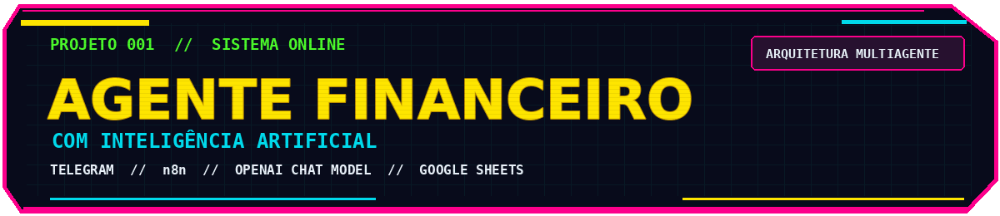
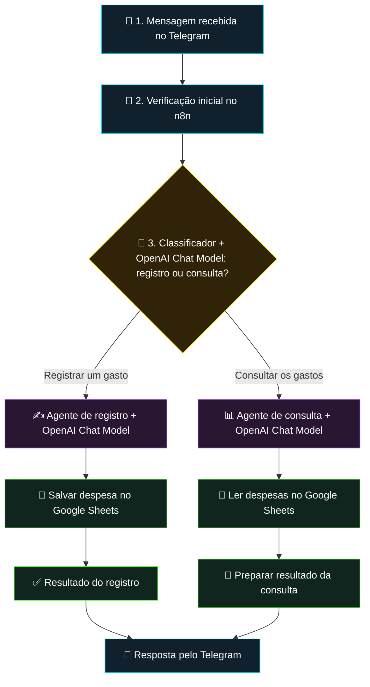
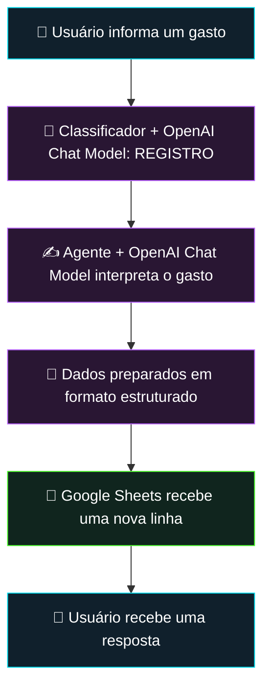
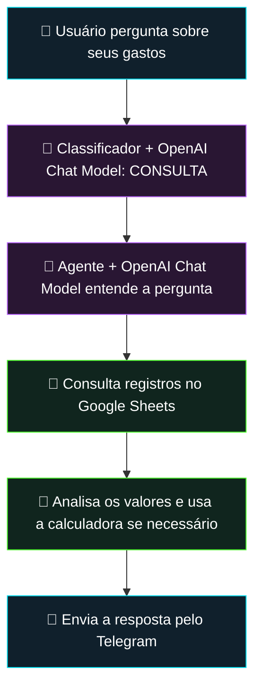

  

# ⚡ Agente Financeiro com IA

### Gestão de despesas por conversa, com classificação de intenções e agentes especializados

  
  
  
  

**Uma mensagem no Telegram pode se transformar em um registro financeiro ou em uma consulta aos gastos já armazenados.**

---

## 01 // Visão geral

O **Agente Financeiro com IA** foi desenvolvido em um projeto prático da **Jornada de Dados** para simplificar o acompanhamento de despesas pessoais permitindo que seja realizado o controle financeiro de qualquer lugar a qualquer momento com um simples envio de mensagem.

O usuário envia uma mensagem pelo **Telegram**. O **n8n** recebe a solicitação e encaminha o conteúdo a um **classificador de texto conectado a um nó OpenAI Chat Model**. A partir da intenção identificada, o fluxo segue por um dos dois agentes especializados:

- **Agente de registro:** interpreta um novo gasto, organiza as informações e adiciona uma linha ao **Google Sheets**.
- **Agente de consulta:** interpreta perguntas sobre despesas registradas, consulta a planilha e pode utilizar uma **calculadora** como ferramenta de apoio.

Ao final, o usuário recebe a resposta pelo próprio Telegram.

## 02 // Demonstração do projeto

A demonstração original da automação está disponível em uma publicação no LinkedIn:

## 03 // Arquitetura: o caminho da mensagem

O projeto possui **três componentes inteligentes**, e **cada um é conectado ao seu próprio nó `OpenAI Chat Model`**: um classificador para identificar o pedido e dois agentes especializados para executá-lo.

### Os três componentes inteligentes

| Componente | O que faz | Apoios observados na arquitetura original |
|---|---|---|
| **1. Classificador de intenções** | Interpreta a mensagem para escolher **registro** ou **consulta**. | `Text Classifier` + `OpenAI Chat Model` próprio. |
| **2. Agente de registro** | Interpreta o pedido e prepara os dados da despesa para registro. | `OpenAI Chat Model` próprio, analisador de saída estruturada e Google Sheets para adicionar linha. |
| **3. Agente de consulta** | Entende a pergunta, utiliza os registros e prepara uma resposta. | `OpenAI Chat Model` próprio, leitura do Google Sheets e calculadora. |

### Como os modelos de IA participam das decisões

O `OpenAI Chat Model` funciona como **modelo de linguagem conectado ao componente**. Cada conexão atende a uma responsabilidade distinta:

1. **Identificar a intenção:** o modelo do classificador ajuda a interpretar a mensagem e distinguir entre **registrar** e **consultar**.
2. **Interpretar um registro:** o modelo do agente de registro ajuda a extrair e organizar as informações de uma despesa a partir do texto; o **analisador de saída estruturada** auxilia na formatação dos dados para o fluxo.
3. **Interpretar uma consulta:** o modelo do agente de consulta ajuda a entender a pergunta e a compor uma resposta a partir dos **dados lidos no Google Sheets**, podendo contar com a **calculadora** para operações numéricas.

Os modelos ajudam a **interpretar linguagem natural e produzir resultados úteis**, enquanto os nós e ferramentas do n8n cuidam de encaminhar mensagens, consultar ou gravar dados e responder ao usuário.

## 04 // Como funciona na prática

### Caminho 1 — Registrar uma despesa

**Exemplo ilustrativo:** “Registra um almoço de R$ 42,90 hoje.”

**Em palavras:** o classificador identifica um pedido de registro; o agente interpreta a mensagem com apoio de seu próprio nó `OpenAI Chat Model` e de um analisador de saída estruturada; o fluxo possui uma operação para **adicionar uma linha no Google Sheets** e outra para **responder pelo Telegram**.

### Caminho 2 — Consultar despesas

**Exemplo ilustrativo:** “Quanto eu gastei com alimentação?”

**Em palavras:** o classificador identifica uma consulta; o agente, conectado ao seu próprio `OpenAI Chat Model`, usa a **leitura do Google Sheets** para acessar os registros e dispõe de uma **calculadora** para apoiar operações matemáticas; depois, devolve uma resposta no Telegram.

## 05 // Tecnologias utilizadas

| Tecnologia | Utilização |
|---|---|
| **n8n** | Orquestração dos fluxos e integração entre serviços. |
| **Telegram Bot API** | Entrada das solicitações e comunicação das respostas. |
| **OpenAI Chat Model (n8n)** | Três nós de modelo de linguagem: um associado ao classificador, um ao agente de registro e um ao agente de consulta.|
| **Google Sheets** | Persistência das despesas e recuperação de registros. |
| **Analisador de saída estruturada do n8n** | Apoio à estruturação dos dados produzidos pelo agente de registro. |
| **Calculadora do n8n** | Ferramenta de cálculo conectada ao agente de consulta. |

## 06 // Decisões técnicas e aprendizados

**Separação de responsabilidades.** A arquitetura utiliza um `OpenAI Chat Model` em cada componente inteligente, diferenciando a identificação da intenção da execução da tarefa. O classificador decide qual caminho seguir, enquanto os agentes de registro e consulta cuidam de responsabilidades específicas.

**Estruturação antes da persistência.** O agente de registro, apoiado por seu `OpenAI Chat Model`, conta com um analisador de saída estruturada, uma escolha importante quando a resposta de um modelo precisa ser convertida em dados para armazenamento.

**Acesso a ferramentas no agente de consulta.** Em vez de depender apenas das respostas de seu `OpenAI Chat Model`, o agente possui conexões para **ler dados da planilha** e utilizar uma **calculadora**. Isso permite consultar informações externas ao modelo e executar operações com esses dados.

**Interface conversacional.** O Telegram concentra as interações em mensagens, enquanto o n8n coordena os serviços necessários para atender cada tipo de solicitação.

  

